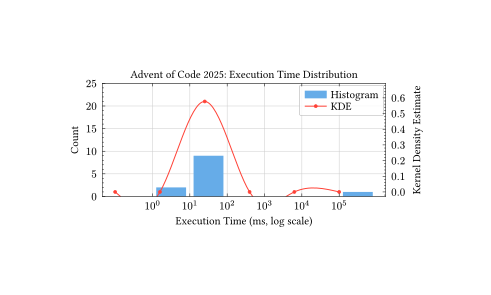
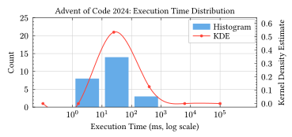
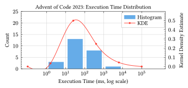

# Advent of Code

> Advent of Code is an Advent calendar of small programming puzzles for a variety of skill sets and skill levels that can be solved in any programming language you like. People use them as a speed contest, interview prep, company training, university coursework, practice problems, or to challenge each other.

* [adventofcode.com](https://adventofcode.com/)
* [r/adventofcode](https://www.reddit.com/r/adventofcode/)
* [unofficial survey](https://jeroenheijmans.github.io/advent-of-code-surveys/)
* [my old data visualizer](https://github.com/shnarazk/AoCVisualizer)

I solve all the problems in Rust and sometimes use some other interesting languages.

## 2026

* [calendar](https://adventofcode.com/2026)

## 2025

* [calendar](https://adventofcode.com/2025)
* [execution time in Rust](https://github.com/shnarazk/advent-of-code/blob/main/src/y2025/README.md)

- day04: a graph is the best for propagating changes instead of 2D matrix
- day09: problem contains only 1K points per axis like [Y2021Day22](https://adventofcode.com/2021/day/22)
- day10: ILP that I've never used

## 2024 completed

* [calendar](https://adventofcode.com/2024)
* [execution time in Rust](https://github.com/shnarazk/advent-of-code/blob/main/src/y2024/README.md)

- day14: define meaningful images mathematically
- day17: this is a search problem that we can solve by Dijkstra nicely
- day18: bisect
- day24: a variant of search problem with a shallow but vast search space requiring mathematical intuition or analysis

## 2023 completed

* [calendar](https://adventofcode.com/2023)
* [execution time in Rust](https://github.com/shnarazk/advent-of-code/blob/main/src/y2023/README.md)

## 2022 completed

* [calendar](https://adventofcode.com/2022)
* [execution time in Rust](https://github.com/shnarazk/advent-of-code/blob/main/src/y2022/README.md)

## 2021 completed

* [calendar](https://adventofcode.com/2021)
* [execution time in Rust](https://github.com/shnarazk/advent-of-code/blob/main/src/y2021/README.md)

- day22: convert to a problem-size small world by heterogeneous scaling!

## 2020 completed

* [calendar](https://adventofcode.com/2020)
* [execution time in Rust](https://github.com/shnarazk/advent-of-code/blob/main/src/y2020/README.md)

## 2019 completed

* [calendar](https://adventofcode.com/2019)
* [execution time in Rust](https://github.com/shnarazk/advent-of-code/blob/main/src/y2019/README.md)

## 2018 completed

* [calendar](https://adventofcode.com/2018)
* [execution time in Rust](https://github.com/shnarazk/advent-of-code/blob/main/src/y2018/README.md)

## 2017 completed

* [calendar](https://adventofcode.com/2017)
* [execution time in Rust](https://github.com/shnarazk/advent-of-code/blob/main/src/y2017/README.md)

## 2016 completed

* [calendar](https://adventofcode.com/2016)
* [execution time in Rust](https://github.com/shnarazk/advent-of-code/blob/main/src/y2016/README.md)

## 2015 completed

* [calendar](https://adventofcode.com/2015)
* [execution time in Rust](https://github.com/shnarazk/advent-of-code/blob/main/src/y2015/README.md)
